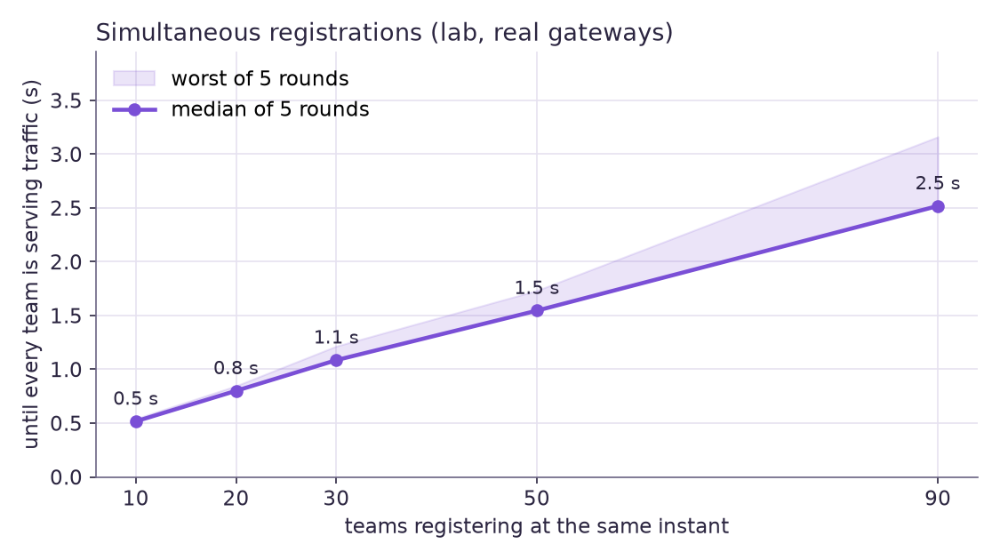
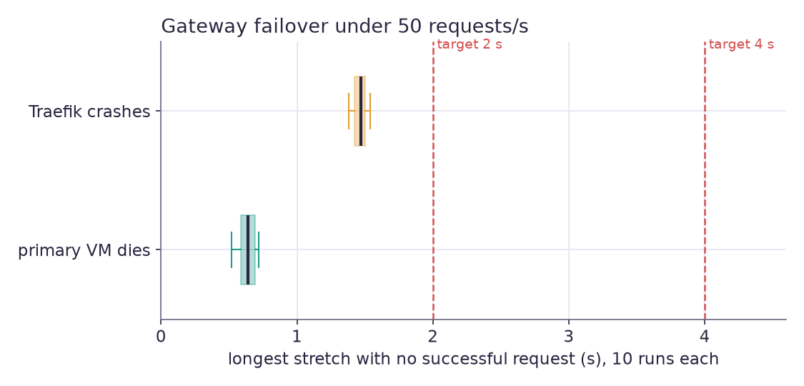
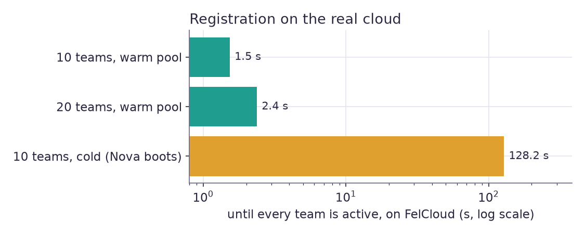

# Benchmark report

Provisioning latency, simultaneous registrations, gateway failover, address recycling and load,
measured on two environments that this report keeps apart, plus what the measuring changed.

- [Summary](#summary) · [Environments and method](#environments-and-method)
- [Lab results](#lab-results): [provisioning](#provisioning-latency) ·
  [bursts](#simultaneous-registrations) · [failover](#gateway-failover) ·
  [expiry and recycling](#expiry-and-ip-recycling) · [rollback](#config-rollback) ·
  [throughput](#gateway-throughput) · [control-plane crash](#control-plane-killed-under-load)
- [Results on FelCloud](#results-on-felcloud) · [with the real gateways](#on-felcloud-with-the-real-gateways)
- [What the benchmarks changed](#what-the-benchmarks-changed) · [Caveats](#caveats) ·
  [Reproduce](#reproduce)

## Summary

| Question | Answer | Where |
| --- | --- | --- |
| How fast is one registration? | **0.4 s** from request to serving traffic through both gateways (lab, warm path) | [provisioning](#provisioning-latency) |
| Do 10+ simultaneous registrations work? | **Yes: 10, 20, 30, 50 and 90 at the same instant, 5 rounds each, 1,000 teams in all: 1,000 `active`, 0 failures, 0 duplicate addresses, every host served by its own sandbox** | [bursts](#simultaneous-registrations) |
| Through the real gateways? | **active 0.6 s after the request** onto a booted sandbox, served from the internet by its own VM; onto a VM still booting, active when it serves (94 s), first attempt | [real gateways](#on-felcloud-with-the-real-gateways) |
| How long do they take? | whole burst served in **0.5 s (10), 0.8 s (20), 1.1 s (30), 1.5 s (50), 2.5 s (90)** (lab); **on FelCloud, 20 at once: 2.4 s warm** | [bursts](#simultaneous-registrations), [FelCloud](#results-on-felcloud) |
| And with no warm VM (cold)? | the platform adds under half a second; **on FelCloud the Nova boot dominates: ten concurrent cold registrations took 108–140 s**, so the pool grows with demand | [FelCloud](#results-on-felcloud) |
| Gateway failover time? | **between two real FelCloud VMs: primary loses power 1.0 s, Traefik down 1.36 s, planned failover 0.24 s**; lab: 0.52–0.72 s, 1.4–1.5 s, 0.12 s (longest silence in a 50 requests/s stream; targets 2 s / 4 s) | [real VMs](#on-felcloud-with-the-real-gateways), [lab](#gateway-failover) |
| IP recycling speed? | route and DNS gone **1.5 s** after expiry; an address is reusable **about 2 s after its quarantine ends**; **FelCloud: 20 teams torn down in 14 s, 10 in 4.5–6 s, addresses free about 7 s later with a 5 s quarantine** | [recycling](#expiry-and-ip-recycling) |
| Load? | **2,000 requests/s** across 30 teams' hosts, new connection each, 0 failures, p99 5.6 ms (lab; the generator's limit before the gateways') | [throughput](#gateway-throughput) |
| Control plane down? | killed with `-9` for 8 s under 100 requests/s: **0 failed requests**; back and registering in 1 s | [crash](#control-plane-killed-under-load) |
| Rollback? | pinning the previous config reaches both gateways in **0.15 s** median | [rollback](#config-rollback) |

## Environments and method

**Lab** (`tests/load`, `tests/chaos`): a 20-thread i7-13650HX laptop with 16 GB, Linux 7.2, PostgreSQL
18, Python 3.14 / 3.12, Traefik 3.7.10, keepalived 2.4.3, in an unprivileged user/network namespace
lab. Everything on the request and configuration path is real: two gateways each running
keepalived, Traefik and the Go `ipo-agent`; the control plane (48 saga workers, all controllers);
a PostgreSQL; a DNS server that takes signed RFC 2136 updates. Two things are not real: the cloud
(a fake that creates servers instantly, so VM boot time is *not* in the lab numbers) and the
sandboxes (one process answering on all 100 pool addresses and echoing the address it was reached
on). Load generators run on the same machine. Treat the lab as a measurement of the platform's
own overhead and of the failover machinery, not of a deployment's absolute speed.

**FelCloud** (`control-plane/bench/real_cloud.py`): the control plane running locally against the
real OpenStack API of the team's project (Nova, Neutron, Glance), real `sandbox-net` and security
groups built by `pulumi up`, sandbox VMs of flavor `G0.basic.1c1g` booted from the stock *Debian
13 - Trixie* image (not the baked one). No gateways stand behind it, so these runs measure the
cloud's contribution and the control plane's use of it, and registration is judged `active` when
the saga finishes, not by a request through a VIP.

**Definitions.** *Accepted*: the HTTP response to `POST /v1/teams`. *Active*: the team's state is
`active` (route acknowledged by both gateways and probed). *Serving*: the first request for the
team's subdomain through the VIP is answered 200 *by that team's sandbox* (the sandbox echoes the
address it was reached on, and the test compares it with the address the API assigned). A burst's
*whole-burst time* runs from the instant the threads are released to the last team serving. A
failover *gap* is the longest stretch with no successful request in a stream of 50 new connections
per second. *Recycling overhead* is the time from an address's quarantine ending to the address
being `free` again.

## Lab results

### Provisioning latency

One team at a time, each deleted before the next, so the platform is otherwise idle.

| Path | Teams | OK | API accepts p50 (s) | Active p50 (s) | Serving p50 (s) | Serving p95 (s) | Serving max (s) |
| --- | --- | --- | --- | --- | --- | --- | --- |
| Warm (VM already booted, one team at a time) | 50 | 50/50 | 0.02 | 0.36 | 0.37 | 0.39 | 0.47 |
| Cold (address reserved and VM created on demand) | 10 | 10/10 | 0.02 | 0.36 | 0.36 | 0.47 | 0.47 |

The API answers in about 20 ms; the remaining ~0.35 s is the saga (route, config compile, push to
both agents, verify, swap, converge, probe, acknowledge). Cold looks no slower than warm here only
because the fake cloud boots instantly: on a real cloud it adds a Nova boot ([below](#results-on-felcloud)).

### Simultaneous registrations

Each round: *N* threads released together, each `POST /v1/teams` with its own idempotency key,
then polls until `active`, then requests its subdomain through the VIP until a sandbox answers.
The warm pool is set to *N* and settled first, and previous teams are gone.



| Simultaneous teams | Rounds | Succeeded | Duplicate addresses | Median team served (s) | Whole burst served, median (s) | Whole burst, worst (s) | Slowest single team (s) |
| --- | --- | --- | --- | --- | --- | --- | --- |
| 10 | 5 | 50/50 | 0 | 0.50 | 0.52 | 0.54 | 0.54 |
| 20 | 5 | 100/100 | 0 | 0.71 | 0.80 | 0.85 | 0.85 |
| 30 | 5 | 150/150 | 0 | 0.89 | 1.08 | 1.22 | 1.21 |
| 50 | 5 | 250/250 | 0 | 1.33 | 1.54 | 1.73 | 1.73 |
| 90 | 5 | 450/450 | 0 | 2.11 | 2.52 | 3.16 | 3.16 |

A burst of 12 teams against a warm pool of 3: 3 warm and 9 cold claims, 12/12 succeeded, whole burst served in 0.66 s.

A burst of 12 teams against a warm pool of only 3 takes the cold path for nine of them and is
still served in under a second. Time grows about linearly, roughly 25 ms per team: the compiler
batches whatever route changes arrive while a version is being pushed, and each version is applied
and verified on both gateways. A further test registers 95 teams in all (45, then 50 more at once,
1.9 s) so that the routing table is longer than the 100 routers Traefik lists a page:
that case once rolled every config back (see below).

Besides the timing, the same checks run in the continuous-integration suite without the gateways
(`control-plane/tests/test_concurrent_registration.py`): fifteen simultaneous registrations all
succeed on fifteen distinct addresses with both agents holding every route; twelve calls with one
idempotency key create one team; ten claims on one name have exactly one winner; transient
Nova and Neutron errors during a burst are absorbed by step retries.

### Gateway failover

Real keepalived, Traefik and agents under 50 new connections per second.



| Failure | Runs | Requests lost in the gaps | Shortest gap (s) | Median gap (s) | Longest gap (s) |
| --- | --- | --- | --- | --- | --- |
| Primary gateway VM dies (power off) | 10 | 308 | 0.52 | 0.64 | 0.72 |
| Traefik crashes on the primary (kill -9) | 10 | 722 | 1.38 | 1.47 | 1.54 |
| keepalived stopped cleanly | 1 | 5 | 0.12 | 0.12 | 0.12 |
| Manual failover through the agent | 1 | 5 | 0.12 | 0.12 | 0.12 |

Targets were 2 s and 4 s. The Traefik case is slower because the health check must fail twice (one
second apart) before the standby takes over. "Requests lost" counts the requests sent during the
gaps (about 30 per run at this rate): connections to a VIP nobody held for half a second. The
SIGTERM variant, an old master returning, and a partition that makes two masters are also
covered by the suite ([testing](../guides/testing.md)).

### Expiry and IP recycling

Twenty teams whose leases are made to expire at once, with a 5 s quarantine so the run is short;
the route and DNS probes poll about every half second, so the first three columns are upper bounds.

| Teams | Quarantine (s) | Route gone (s) | DNS gone (s) | Team deleted (s) | Address free (s) | Recycle overhead p50 / max (s) |
| --- | --- | --- | --- | --- | --- | --- |
| 20 | 5 | 1.52 | 1.52 | 1.52 | 7.16 | 2.16 / 2.16 |

From expiry, every one of the twenty hosts answers 404 and has no DNS record within about 1.5 s
(reaper tick, teardown, both gateways acknowledging, record withdrawn); a further quarantine plus
about 2 s later the address is `free` again and a new burst of 20 is served from the same
addresses. With the default 60 s quarantine, an address is reusable about 62 s after its lease
ends. The quarantine, not the machinery, is the dominant term and is an admin setting.

### Config rollback

Pinning the previous configuration (an operator's rollback) twenty times: 20 rollbacks: p50 0.151 s, p95 0.227 s, max 0.234 s until both gateways run it. A failed probe
makes the agent roll back by itself without waiting for an operator.

### Gateway throughput

Thirty teams registered, requests spread over their 30 hosts, a new TCP connection for each
request, 8 s per rate.

| Offered (req/s) | Achieved (req/s) | Failed | p50 (ms) | p95 (ms) | p99 (ms) |
| --- | --- | --- | --- | --- | --- |
| 200 | 200 | 0/1601 | 1.9 | 2.5 | 2.7 |
| 500 | 500 | 0/4001 | 1.6 | 2.5 | 2.7 |
| 1000 | 1000 | 0/8001 | 1.6 | 2.8 | 3.4 |
| 2000 | 2000 | 0/16001 | 1.7 | 4.1 | 5.6 |

No failures up to the highest rate tried, and latency barely moves. The generator, the gateways,
Traefik and the backend share one machine, so this is a lower bound on what a gateway VM does,
not a capacity figure.

### Control plane killed under load

`kill -9` the control plane under 100 requests/s for one team, wait 8 s, start it again.

| Run | Down for (s) | Requests | Failed | Restart to serving (s) | p99 (ms) |
| --- | --- | --- | --- | --- | --- |
| 1 | 8 | 1353 | 0 | 0.99 | 3.0 |
| 2 | 8 | 1350 | 0 | 0.98 | 3.1 |
| 3 | 8 | 1349 | 0 | 0.97 | 3.1 |

The gateways keep serving the last configuration they verified. After the restart the plane
knows the existing team and registers a new one (checked in each run).

## Results on FelCloud

`uv run python -m bench.real_cloud` against the project's real OpenStack API, 2026-10-17
(raw lines: [`benchmarks-real-cloud.jsonl`](benchmarks-real-cloud.jsonl) for ten teams,
[`benchmarks-real-cloud-20.jsonl`](benchmarks-real-cloud-20.jsonl) for twenty). FelCloud's boot
times varied from run to run; the ranges give all of them.



| Measurement | Result |
| --- | --- |
| One VM, created and booted alone | **17 s** to ACTIVE; a delete is accepted in 0.1 s and the VM is gone 5 s later |
| Warm pool filled (VMs booted 10 at a time) | 10 VMs in **68 s**; 20 VMs in **145 s**. Nova boot per VM: p50 41–57 s, max 64–75 s. Neutron port creation: p50 1.3–1.8 s |
| **10 simultaneous registrations, warm** | **all 10 `active` in 1.5 s** (median team 1.0 s), 0 failures, 10 distinct addresses |
| **20 simultaneous registrations, warm** | **all 20 `active` in 2.4 s** (median team 1.8 s), 0 failures, 20 distinct addresses. Setting the team's metadata on the real VM: p50 0.26 s |
| **10 simultaneous registrations, cold** (no warm VM) | **108–140 s** for the last team across three runs (83–190 s in all); median team 84–113 s, first team 62–93 s. Ten concurrent boots take much longer than a single one |
| **Teardown** | **10 teams in 4.5–6 s, 20 in 14 s**. Delete server p50 0.13–0.3 s, delete port p50 0.5–0.8 s |
| **IP recycling** (5 s quarantine) | addresses `free` after **6.4–8.7 s** (p50 7.1–7.5 s), i.e. about 2.3 s over the quarantine. With the default 60 s quarantine: about 63 s |

What this says:

- Warm registration on a real cloud is as fast as in the lab (a second or two), because it does no
  Nova work: it takes a booted VM from the pool and labels it. That is the reason the pool exists.
- A cold registration costs a minute or two on this cloud when many arrive together. Ten
  concurrent boots are far slower than one (17 s alone), so a pool sized for the expected burst is
  the lever, not parallelism. The pool therefore **grows to the teams registered in the last 15
  minutes** (up to `pool.max_size`, default 40) and shrinks when they pass: after a wave of 30, the
  next wave of 30 is warm. It refills 10 boots at a time.
- Teardown and recycling are quick and dominated by the quarantine setting.

Not measured on FelCloud: requests through a real VIP and floating IP (nothing answers behind them
until the Ansible roles run), and failover between two OpenStack VMs.

## On FelCloud with the real gateways

The whole platform deployed by its Ansible roles on six FelCloud VMs
([the deployment](real-deployment.md)): two gateways (keepalived, Traefik, `ipo-agent`, mutual
TLS), two control-plane replicas, Postgres primary and replica. Load came from the bastion: 50 new
connections per second to the **floating IP**, so every request crossed the internet-facing path
(floating IP → VIP → the MASTER's Traefik).

| Failure | Requests | Failed | Longest gap |
| --- | --- | --- | --- |
| MASTER VM loses power (Nova hard reboot) | 2,251 | 49 | **1.00 s** |
| Traefik killed on the MASTER (systemd restarts it within a second; no failover needed) | 1,251 | 65 | **1.32 s** |
| Traefik stopped on the MASTER and left down (two failed checks, FAULT) | 1,251 | 67 | **1.36 s** |
| Planned failover: `POST /v1/gateways/failover` → agent `/fault` over mutual TLS | 1,001 | 11 | **0.24 s** |

Raw lines: [`failover-real-cloud.jsonl`](failover-real-cloud.jsonl). The real VMs take a little
longer than the lab for a dead VM (1.0 s against 0.6 s), as the network has to relearn where the
VIP lives; all are well inside the 2 s and 4 s targets. The rebooted gateway rejoined as BACKUP
without taking the VIP back.

**Registration through the real gateways** (control plane on its two real hosts with the fake
cloud adapter; sandboxes booted from the baked image at the addresses it assigned):

| Case | Result | Steps |
| --- | --- | --- |
| Sandbox already serving | **active 0.6 s after the request**, first attempt | config on both gateways 0.22 s; probe through the gateways 0.04 s |
| Sandbox created at the same moment | **active 94 s after the request**, first attempt | route loaded on both gateways in 2.4 s (Traefik 504 until the VM is up); probe waited 79 s for the VM |

Both served the team's own VM to a laptop on the internet through the floating IP. A FelCloud guest
serves about 90 s after it is created whichever image it boots: the baked `ipo-sandbox-v1` is
ACTIVE in 20 s and serving in 88 s, stock Debian in 24 s and 102 s. So a cold registration on this
cloud takes a minute and a half however the platform is tuned, and the warm pool (which grows to
recent demand) is what makes registration fast.

## What the benchmarks changed

Measuring found nine defects, all fixed and covered by regression tests (the real deployment then found 21 more, listed in [its report](real-deployment.md#defects-found-and-fixed)):

| Found by | Defect | Before → after |
| --- | --- | --- |
| first 30-team burst (lab) | Traefik applies at most one provider change per 2 s by default, so each config version cost two seconds on each gateway | 30 teams: **15 s → 3.3 s** (`providersThrottleDuration` 100 ms) |
| burst scaling (lab) | config versions were compiled at most once a second while routes kept arriving, two (then eight) saga workers each waited on gateway acknowledgements, and the lab itself ran 8 workers although this report said 24 | batching that compiles after 30 ms and at most every 150 ms (changes arriving during a push join the next), a 25 ms Traefik throttle, **48 workers woken by `NOTIFY`** (idle workers cost no queries): 30 teams **3.3 s → 1.1 s**, 50 teams **5.7 s → 1.5 s**, 90 teams (the usable pool) **2.5 s** |
| a 90-team burst (lab) | the agent paged Traefik's router list by following `X-Next-Page`, which names page 1 again on the last page; with more than about a hundred routers it looped until the converge timeout and rolled every config back as "did not converge" | follow a page only if it is later, never list a name twice: 95 teams served. This would have broken registration past about 95 teams |
| lifecycle test (lab) | the admin's runtime quarantine setting was ignored by teardown | now read live |
| lifecycle test (lab) | a teardown retried after a partial release found the lease already quarantined and deleted nothing | the retry deletes what is left |
| first FelCloud run | a "warm" claim could take an address whose VM Nova was still booting, waiting out the boot while reporting the warm path | only pooled leases with a running VM are claimable and counted |
| first FelCloud run | the reconciler deleted VMs that were still building (a boot outlasts its 30 s grace and the VM is not yet matched to its port), then failed their teams | a building VM is not an orphan; its name says which address it is for |
| second FelCloud run | teardown's check for leftovers counted servers Nova had accepted a delete for or keeps listing as DELETED, so every teardown failed over to the reconciler's minute | those are not counted or reused: **10 teams torn down in 85 s → 6 s** |
| cold bursts on FelCloud | cold registrations take minutes and the pool was a fixed size | the pool follows demand: **grows to the last 15 minutes' registrations** (`pool.max_size`), shrinks after |
| a booting sandbox on the real gateways | the gateway rolled back a config whose new team's VM did not answer yet, and every later change carried that route again: one slow VM blocked all registrations | only a missing route or a failing canary rolls back; Traefik gives up on an unreachable backend in 2 s; registration waits for the VM through the gateways: **94 s, first attempt** |

## Caveats

- **Lab numbers are not deployment numbers.** One machine runs the load generator, both gateways,
  the control plane and the database; the cloud is instant. They measure the platform's overhead
  and prove its behaviour under concurrency.
- **FelCloud is a shared cloud and its boot times varied** (a single VM 17 s; ten at once 20–100 s
  to boot; whole cold bursts of 83–190 s across runs). The FelCloud runs were made with the
  control plane at different points of this work; the warm-path numbers do not depend on the
  changes to config batching, because no gateways stood behind them.
- **Failover is measured both ways**: with the real software in namespaces (many runs) and between two real FelCloud VMs (one run of each failure).
- The cold FelCloud numbers use the stock Debian image; the baked image (Podman and the
  application preinstalled) would shorten the first-boot work but not Nova's scheduling and
  image-copy time.
- Single runs for keepalived stop and manual failover; ten for the rest; five rounds for bursts;
  three for the crash; one to three cold FelCloud rounds.

## Reproduce

```bash
cd tests
uv sync --group deploy && sh lab/fetch-tools.sh
uv run python -m load.bench                 # lab: load + chaos suites, then the tables (about 10 min)
uv run python -m load.run -k simultaneous   # just the bursts (IPO_LOAD_SIZES=10,20,30,50,90, IPO_LOAD_ROUNDS=5)

# FelCloud (needs the platform built: uv run python -m chaos.cloud up --clouds ~/clouds.yaml)
cd ../control-plane
uv run python -m bench.real_cloud --clouds ~/clouds.yaml --count 20 --cold-rounds 1 --out real.jsonl
cd ../tests && uv run python -m chaos.cloud destroy --clouds ~/clouds.yaml
```

`load.report RUN_DIR` regenerates the lab tables from a run's `load-report.jsonl` and
`chaos-report.jsonl`; `docs/reports/charts.py RUN_DIR real.jsonl` redraws the charts.
